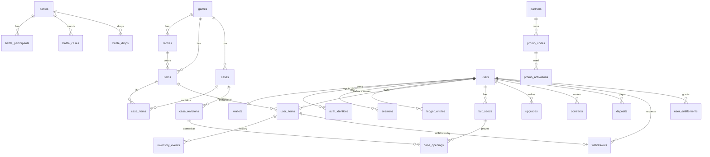

# GunRaid — схема БД

> Статус: **предложение этапа 0.** Таблицы создаются по этапам (см. [план](roadmap.md)); здесь — целевая схема целиком, чтобы связи были продуманы заранее.

## Соглашения

- PostgreSQL 18, имена в `snake_case`, время — `timestamptz`.
- Первичные ключи — `uuid` (UUIDv7: упорядочены по времени, не перебираются), генерируются в приложении. Журналы (ledger, события, логи) — `bigint identity`.
- Все суммы — баланс, цены, ставки, выигрыши, бонусы, призы — `bigint` в **гемах** (1 гем — минимальная единица, дробных гемов нет). Реальные деньги встречаются только у пополнений: сумма и валюта оплаты хранятся отдельно (`numeric`).
- Шансы кейса — `integer` в единицах 0,00001 % (100 % = 10 000 000). Шанс апгрейда — `integer` в миллионных долях.
- Тексты, которые редактируются в админке, — `jsonb` вида `{"ru": "…"}`.
- Все игровые сущности несут `game_id`.
- Статусы и типы — enum'ы PostgreSQL (новые значения добавляются миграцией).

## Основные связи

---

## 1. Игры и каталог

**games** — игры.
`id smallint PK`, `code` (`standoff2`, `cs2`, unique), `name`, `is_active`, `sort_order`, `features jsonb` (например `{"wear": true, "float": true}` у CS2), `withdraw_provider` (код реализации вывода).

**rarities** — редкости по игре (не в коде).
`id`, `game_id → games`, `code`, `name jsonb`, `color` (`#RRGGBB`), `sort_order`; unique `(game_id, code)`.

**item_types** — типы предметов.
`id`, `code` (`weapon`, `knife`, `gloves`, `sticker`, `charm`, `graffiti`, …), `name jsonb`, `sort_order`.

**item_models** — модели оружия, ножей, перчаток (для фильтра «модель оружия»).
`id`, `game_id`, `type_id → item_types`, `code`, `name`; unique `(game_id, code)`.

**collections** — коллекции.
`id`, `game_id`, `code`, `name`, `image_url`.

**items** — каталог. Строка = конкретный продаваемый вариант (в CS2 каждый износ и StatTrak — отдельная строка со своей ценой).
`id uuid`, `game_id`, `type_id`, `model_id?`, `rarity_id`, `collection_id?`, `skin_name`, `full_name`, `market_name` (ключ сопоставления для импорта и цен, unique в игре), `image_url`, `price bigint` (гемы), `price_updated_at`, `is_stattrak`, `is_souvenir`, `wear?` (FN/MW/FT/WW/BS — только CS2), `float_min?`, `float_max?` (`numeric(6,5)`), `is_withdrawable`, `in_upgrade` (может быть целью апгрейда), `in_contract` (может выпасть в контракте), `is_active`, `created_at`, `updated_at`.
Индексы: `(game_id, is_active, price)`, `(game_id, rarity_id)`, `(game_id, model_id)`, триграммный по `full_name` для поиска.

**item_price_history** — история цен.
`id bigint`, `item_id`, `price` (гемы), `source_price?` и `source_currency?` (если цена пришла в долларах), `source` (`csv`, `manual`, `bulk`, `provider:…`), `actor_id?`, `created_at`.

**catalog_imports** — CSV-импорты.
`id`, `game_id`, `actor_id`, `file_name`, `status`, `stats jsonb` (создано / обновлено / пропущено), `errors jsonb`, `created_at`, `finished_at`.

## 2. Пользователи и вход

**users**
`id uuid`, `short_id bigint identity` (публичный номер, ссылка `/…/u/123456`), `nickname`, `avatar_url`, `role` (`user` / `support` / `admin`), `status` (`active` / `banned`), `ban_reason?`, `level`, `xp bigint`, `adult_confirmed_at?`, `adult_confirmed_ip?`, `selected_game_id`, `sound_enabled`, `fast_mode_default`, `referral_code` (unique), `referred_by_id? → users`, `is_suspicious`, `suspicious_note?`, `first_deposit_at?`, `created_at`, `last_seen_at`.

**auth_identities** — привязанные способы входа.
`id`, `user_id`, `provider` (`steam` / `google` / `telegram`), `provider_user_id`, `profile jsonb` (ник, аватар, email Google, username Telegram), `created_at`, `last_login_at`; unique `(provider, provider_user_id)`, unique `(user_id, provider)`.

**sessions**
`id uuid` (= `sid` в access-токене), `user_id`, `refresh_token_hash`, `family_id` (цепочка ротации), `ip`, `user_agent`, `device_id`, `created_at`, `last_used_at`, `expires_at`, `revoked_at?`, `revoke_reason?`.

**user_game_profiles** — данные для вывода по игре.
PK `(user_id, game_id)`, `trade_url?` (CS2, проверка формата), `game_player_id?` (ID Standoff 2), `updated_at`.

**user_access_log** — IP и устройства (антимультиаккаунт).
`id bigint`, `user_id`, `event` (`login`, `refresh`, `deposit`, `withdraw`), `ip inet`, `device_id`, `fingerprint_hash`, `user_agent`, `created_at`. Индексы по `ip` и `device_id` → «связанные аккаунты» в админке.

**admin_user_notes** — заметки админов о пользователе.
`id`, `user_id`, `author_id`, `text`, `created_at`.

## 3. Баланс (гемы) и пополнения

**wallets** — общий баланс пользователя в гемах (один на все игры).
`user_id PK`, `balance bigint CHECK (balance >= 0)`, `last_entry_id`, `updated_at`.

**ledger_entries** — журнал движения гемов, только INSERT.
`id bigint identity`, `user_id`, `type`, `amount bigint` (± ), `balance_after`, `ref_type`, `ref_id`, `idempotency_key` (unique), `actor_id?` (админ), `reason?` (обязательна для `admin_adjustment`), `meta jsonb`, `created_at`.
Типы: `deposit`, `deposit_bonus`, `deposit_reversal`, `case_open`, `item_sell`, `upgrade_stake`, `battle_entry`, `battle_refund`, `wheel_prize`, `promo_balance`, `daily_bonus`, `level_reward`, `referral_reward`, `leaderboard_prize`, `admin_adjustment`. Типа «вывод гемов» нет и не будет: гемы не выводятся, выводятся только предметы.
Индексы: `(user_id, id DESC)`, `(ref_type, ref_id)`, `(type, created_at)`.

**idempotency_requests**
PK `(user_id, key)`, `endpoint`, `request_hash`, `status` (`processing` / `done`), `response jsonb`, `created_at`; чистка старше суток.

**deposits** — пополнения. Реальная валюта живёт только здесь.
`id`, `user_id`, `provider`, `provider_payment_id`, `method`, `pay_currency` (`USD`, `RUB`, `UAH`, `USDT`…), `pay_amount numeric`, `usd_rate numeric` (долларов за единицу валюты — снимок котировки), `gems_per_usd` (снимок курса гемов), `gems_amount`, `bonus_gems`, `bonus_source?` (`first_deposit` / `promo` / `wheel`), `entitlement_id?`, `quote_expires_at`, `status` (`pending` / `succeeded` / `failed` / `cancelled` / `reversed`), `meta jsonb`, `created_at`, `completed_at?`; unique `(provider, provider_payment_id)`.

**payment_events** — входящие вебхуки (идемпотентная обработка).
`id`, `provider`, `event_id` (unique), `payload jsonb`, `signature_ok`, `processed_at?`, `error?`.

**fx_rates** — курсы валют оплаты к доллару для котировок (сейчас задаются в админке, позже — от провайдера через `FxRateProvider`).
`currency PK`, `kind` (`fiat` / `crypto`), `usd_rate numeric` (долларов за 1 единицу), `source` (`manual` / `provider:…`), `is_active`, `updated_at`.

## 4. Инвентарь

**user_items** — экземпляры предметов у пользователей (раздельно по играм).
`id uuid`, `user_id`, `game_id`, `item_id`, `status` (`in_inventory`, `sold`, `withdrawing`, `withdrawn`, `used_upgrade`, `used_contract`, `lost_battle`), `acquired_value` (цена на момент получения), `source_type` (`case`, `upgrade`, `contract`, `battle`, `wheel`, `promo`, `level_reward`, `leaderboard`, `admin`), `source_id`, `acquired_at`, `status_changed_at`, `consumed_ref_type?`, `consumed_ref_id?`, `sold_value?`.
Индекс: частичный `(user_id, game_id, acquired_at)` где `status = 'in_inventory'`.

**inventory_events** — журнал движения предметов.
`id bigint`, `user_item_id`, `user_id`, `type` (смена статуса), `value`, `ref_type`, `ref_id`, `created_at`.

## 5. Provably fair

**fair_seeds** — пары сидов пользователя.
`id uuid`, `user_id`, `server_seed_enc` (зашифрован), `server_seed_hash`, `client_seed`, `nonce` (следующий), `status` (`active` / `revealed`), `created_at`, `revealed_at?`; один `active` на пользователя (частичный unique).

## 6. Кейсы

**case_categories** — разделы главной.
`id`, `game_id`, `code`, `name jsonb`, `sort_order`.

**cases**
`id uuid`, `game_id`, `category_id`, `slug` (unique в игре), `name jsonb`, `image_url`, `price` (0 — бесплатный), `kind` (`paid` / `free`), `min_level?`, `cooldown_seconds?` (бесплатные и уровневые), `supply_total?` и `supply_used` (лимитированные), `available_from?`, `available_until?`, `current_revision_id`, `is_active`, `sort_order`, `created_at`, `updated_at`.

**case_items** — редактируемый состав.
PK `(case_id, item_id)`, `odds integer`, `sort_order`. Сохранение в админке проверяет сумму = 100 % и создаёт новую ревизию.

**case_revisions** — неизменяемые снимки состава для открытий и проверки.
`id`, `case_id`, `version`, `contents jsonb` (упорядоченный массив `{itemId, odds}`), `price`, `rtp` (по ценам на момент сохранения), `created_by`, `created_at`.

**case_openings**
`id uuid`, `user_id`, `game_id`, `case_id`, `revision_id`, `batch_id` (x1–x5 одним запросом), `price_paid`, `is_free`, `source` (`direct` / `battle` / `entitlement`), `fair_seed_id`, `nonce`, `ticket`, `item_id`, `item_value`, `user_item_id`, `created_at`.

**user_cooldowns** — все таймеры пользователя.
PK `(user_id, key)`, `available_at`. Ключи: `free_case:{caseId}`, `wheel`, `daily`.

**banners** — баннеры главной.
`id`, `game_id?`, `image_url`, `title jsonb`, `link`, `sort_order`, `starts_at?`, `ends_at?`, `is_active`.

## 7. Апгрейд и контракт

**upgrades**
`id`, `user_id`, `game_id`, `stake_type` (`items` / `balance`), `stake_amount` (гемы с баланса), `stake_value` (итого), `target_item_id`, `target_price`, `chance` (миллионные доли), `commission` и `max_chance` (снимки настроек), `fair_seed_id`, `nonce`, `roll`, `is_win`, `result_user_item_id?`, `ledger_entry_id?`, `created_at`.

**upgrade_stake_items** — `upgrade_id`, `user_item_id`, `value`.

**contracts**
`id`, `user_id`, `game_id`, `input_value`, `k_min`, `k_max`, `gamma`, `commission`, `fair_seed_id`, `nonce`, `roll`, `multiplier`, `target_value`, `result_item_id`, `result_value`, `result_user_item_id`, `created_at`.

**contract_items** — `contract_id`, `user_item_id`, `value`.

## 8. Кейс-баттлы

**battles**
`id uuid`, `game_id`, `creator_id`, `format` (`1v1`, `1v1v1`, `1v1v1v1`, `2v2`), `max_players`, `mode` (`classic` / `crazy`), `status` (`waiting` / `in_progress` / `finished` / `cancelled`), `entry_price`, `rounds_count`, `current_round`, `total_value`, `server_seed_enc`, `server_seed_hash`, `client_seed?` (фиксируется при старте), `winner_team?`, `created_at`, `started_at?`, `finished_at?`, `cancel_reason?`.

**battle_cases** — кейс каждого раунда.
PK `(battle_id, round_index)`, `case_id`, `revision_id`, `price`.

**battle_participants**
PK `(battle_id, slot)`, `team?`, `user_id?` (пусто у бота), `bot_profile_id?`, `client_seed`, `paid_amount`, `ledger_entry_id?`, `total_value`, `is_winner`, `joined_at`; unique `(battle_id, user_id)`.

**battle_drops**
PK `(battle_id, round_index, slot)`, `item_id`, `item_value`, `roll`, `user_item_id?` (у того, кому предмет достался).

**bot_profiles** — `id`, `nickname`, `avatar_url`.

## 9. Бонусы

**wheel_prizes** — призы колеса (набор на игру, вес — в админке).
`id`, `game_id`, `type` (`balance`, `item`, `free_case`, `deposit_bonus`, `extra_spin`), `amount?`, `item_id?`, `case_id?`, `percent?`, `weight`, `label jsonb`, `color`, `sort_order`, `is_active`.

**wheel_spins**
`id`, `user_id`, `game_id`, `prize_id`, `prize_snapshot jsonb`, `is_extra`, `fair_seed_id`, `nonce`, `roll`, `result_ref_type`, `result_ref_id`, `created_at`.

**user_entitlements** — выданные «права»: бесплатный кейс, дополнительный спин, бонус к пополнению.
`id`, `user_id`, `type` (`free_case`, `wheel_spin`, `deposit_bonus`), `case_id?`, `percent?`, `max_amount?`, `source_type` (`wheel`, `promo`, `level`, `admin`), `source_id`, `status` (`active` / `used` / `expired`), `expires_at?`, `used_at?`, `used_ref_id?`, `created_at`.

**promo_codes**
`id`, `code` (unique без учёта регистра), `type` (`balance`, `deposit_bonus`, `free_case`, `wheel_spin`, `item`), `amount?`, `percent?`, `case_id?`, `item_id?`, `game_id?` (привязка к игре), `total_limit?`, `per_user_limit`, `activations_count`, `starts_at?`, `expires_at?`, `min_deposit_amount?`, `min_deposit_period_days?`, `new_users_max_age_hours?` («только для новых»), `partner_id?`, `is_active`, `created_by`, `created_at`.

**promo_activations** — `id`, `promo_id`, `user_id`, `result_ref_type`, `result_ref_id`, `ip`, `device_id`, `created_at`.

**partners** — блогеры. `id`, `name`, `user_id?`, `contacts`, `note`, `created_at`. Статистика (активации, новые пользователи, их пополнения, GGR) считается запросом.

**daily_bonus_claims** — `id`, `user_id`, `day date` (по часовому поясу сайта), `streak`, `amount`, `ledger_entry_id`; unique `(user_id, day)`.

**levels** — `level PK`, `xp_required`, `reward jsonb` (баланс / бесплатный кейс / спин), `name jsonb?`.

**xp_events** — `id bigint`, `user_id`, `amount`, `source_type`, `source_id`, `created_at`.

**referral_rewards** — `id`, `referrer_id`, `referral_id`, `deposit_id`, `deposit_amount`, `percent`, `amount`, `ledger_entry_id`, `created_at`.

**leaderboards** — `id`, `game_id`, `period` (`day` / `week`), `metric` (`drop_value`), `prizes jsonb` (место → приз), `is_active`.

**leaderboard_periods** — `id`, `leaderboard_id`, `period_start`, `period_end`, `status` (`open` / `finalized`), `standings jsonb` (снимок топа), `finalized_at?`.

**leaderboard_payouts** — PK `(period_id, place)`, `user_id`, `prize jsonb`, `result_ref_type`, `result_ref_id`.

**achievements** — `id`, `code`, `name jsonb`, `description jsonb`, `icon_url`, `condition jsonb` (тип условия из набора, заданного в коде, + параметры: «открыть N кейсов», «выиграть апгрейд с шансом < X %» …), `reward jsonb?`, `sort_order`, `is_active`.

**user_achievements** — PK `(user_id, achievement_id)`, `progress`, `unlocked_at?`.

**notifications** — `id`, `user_id`, `type`, `params jsonb` (текст — по i18n-ключу типа), `link?`, `read_at?`, `created_at`.

## 10. Вывод

**withdrawals**
`id`, `user_id`, `game_id`, `user_item_id`, `item_id`, `value` (цена на момент заявки), `provider` (`cs2_p2p_stub`, `so2_manual`), `status`, `target jsonb` (снимок trade-ссылки / ID Standoff 2), `external_id?`, `listing jsonb?` (данные лота, выставленного игроком в Standoff 2), `operator_id?`, `reason?`, `expires_at?`, `created_at`, `updated_at`.

Статусы CS2: `pending_review → approved → purchasing → trade_sent → trade_accepted → completed`; ответвления `rejected`, `failed`, `cancelled`, `reversed` (отмена сделки в течение 7 дней).
Статусы Standoff 2: `pending_review → awaiting_listing → listing_submitted → completed`; ответвления `rejected`, `expired` (таймаут), `cancelled`.
При `rejected` / `failed` / `expired` / `cancelled` предмет возвращается в инвентарь.

**withdrawal_events** — история статусов.
`id bigint`, `withdrawal_id`, `from_status`, `to_status`, `actor_type` (`user` / `admin` / `system` / `provider`), `actor_id?`, `note?`, `payload jsonb`, `created_at`.

## 11. Система

**settings** — настройки режимов и бонусов.
PK `(key, scope)`: `scope` = `global` или код игры; `value jsonb` (схема на каждый ключ — в `packages/shared`), `updated_by`, `updated_at`. Ключи: `currency` (курс `gemsPerUsd`, время жизни котировки), `deposit` (минимальная сумма, методы), `upgrade`, `contract`, `battle`, `sell`, `wheel`, `daily`, `first_deposit`, `referral`, `xp`, `antifraud`, `withdrawal`, `feed`, `site`.

**admin_audit_log** — `id bigint`, `actor_id`, `action`, `entity_type`, `entity_id`, `before jsonb`, `after jsonb`, `reason?`, `ip`, `created_at`.

**outbox_events** — `id bigint`, `type`, `payload jsonb`, `created_at`, `processed_at?`, `attempts`, `last_error?`.

**stats_daily** — агрегаты для дашборда.
PK `(day, game_id, mode)`, `bets_value`, `payouts_value`, `count`, `unique_users`.
